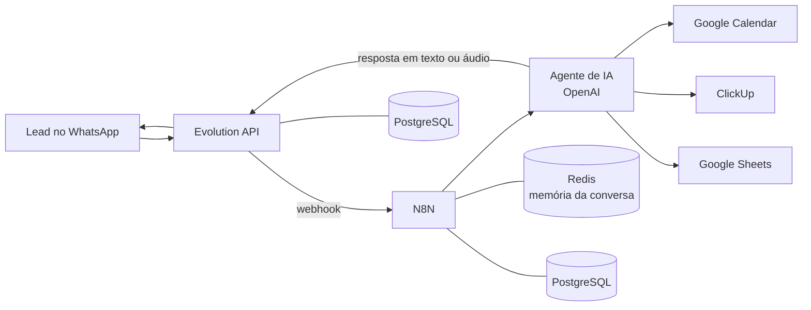

# WhatsApp Automation Stack


Stack pronta para automatizar atendimento e agendamento no WhatsApp: **N8N + Evolution API + PostgreSQL + Redis + HTTPS automático**, já com um workflow de agente de IA que conversa por texto, áudio e imagem, agenda no Google Calendar, cria tarefas no ClickUp e salva os leads no Google Sheets.

[](https://www.hostinger.com/vps/docker-hosting?compose_url=https://raw.githubusercontent.com/turbometacompany-oss/whatsapp-automation-stack/refs/heads/main/docker-compose.yml)

## Como funciona



## O que está incluído

| Serviço | Para que serve |
| --- | --- |
| **N8N** | Executa os workflows e o agente de IA |
| **Evolution API** | Conecta o WhatsApp (envia e recebe mensagens) |
| **PostgreSQL** (2 bancos) | Dados do N8N e da Evolution API |
| **Redis** | Cache da Evolution API e memória de conversa do agente |
| **Caddy** | HTTPS automático (Let's Encrypt) para N8N e Evolution API |

Na primeira inicialização, a stack **instala sozinha o nó `n8n-nodes-evolution-api`** e **importa o workflow** (desativado) para dentro do N8N.

Workflows em [`workflows/`](workflows):

| Arquivo | O que faz |
| --- | --- |
| `01-agente-agendamento-whatsapp.json` | Recebe texto, áudio (transcreve) e imagem (descreve), responde em áudio quando o lead manda áudio, consulta o Calendar, cria o evento, cria a tarefa no ClickUp e registra o lead no Google Sheets. Ignora as mensagens enviadas pelo próprio número, evitando loops. |

## Requisitos

- Um VPS com Docker (na Hostinger, use o **Docker Manager**) com pelo menos 2 GB de RAM
- Um domínio, se quiser HTTPS (recomendado)
- Chave de API da OpenAI
- Contas Google (Calendar e Sheets) e ClickUp
- Um número de WhatsApp para conectar

## Instalação

### Opção 1: um clique na Hostinger

1. Clique no botão **Deploy on Hostinger** acima.
2. No Docker Manager, revise as variáveis e **troque todas as senhas e chaves** que começam com `troque-`.
3. Preencha `N8N_WEBHOOK_URL` e `EVOLUTION_SERVER_URL` (veja a seção [HTTPS e domínio](#https-e-domínio)).
4. Faça o deploy e aguarde os containers ficarem ativos.

### Opção 2: em qualquer servidor com Docker

```bash
git clone https://github.com/turbometacompany-oss/whatsapp-automation-stack.git
cd whatsapp-automation-stack
cp .env.example .env
# edite o .env com suas senhas, chaves e domínios
docker compose up -d
```

Acompanhe a primeira inicialização com `docker compose logs -f n8n`. As linhas `[setup]` mostram a instalação do nó e a importação do workflow.

## Configuração (uma vez)

### 1. Acessar o N8N

Abra `https://n8n.seudominio.com.br` (ou `http://IP_DO_SERVIDOR:5678`) e crie a conta de administrador. O workflow **Agente de agendamento WhatsApp** já aparece na lista, desativado.

> Se ele não aparecer ou o nó da Evolution API estiver como "desconhecido", veja [Solução de problemas](docs/solucao-de-problemas.md).

### 2. Criar as credenciais

| Credencial | Como preencher |
| --- | --- |
| **OpenAI** | Sua chave de API |
| **Redis** | Host `redis`, porta `6379`, sem senha |
| **Evolution API** | URL `http://evolution-api:8080` e a chave definida em `EVOLUTION_API_KEY` |
| **Google Sheets** e **Google Calendar** (OAuth2) | Conecte sua conta Google ([passo a passo](docs/credenciais.md)) |
| **ClickUp** | Token de API ou OAuth2 ([passo a passo](docs/credenciais.md)) |

Abra cada nó que mostra aviso de credencial e selecione a credencial criada.

### 3. Preencher os campos do workflow

| Nó | O que trocar |
| --- | --- |
| **AI Agent** | Todos os textos entre colchetes no prompt, como `[NOME_DA_EMPRESA]` |
| **Append row in sheet in Google Sheets** | Seu documento e aba (colunas: `Nome`, `Telefone`, `Data e hora`, `Tipo de negócio`, `Cidade e região`) |
| **Get availability...** e **Create an event...** | Seu calendário |
| **Create a task in ClickUp** | `Team`, `Space`, `Folder` e `List` da sua conta |

### 4. Conectar o WhatsApp

1. Abra o Evolution Manager em `https://evolution.seudominio.com.br/manager` (ou `http://IP_DO_SERVIDOR:8080/manager`) e entre com a chave `EVOLUTION_API_KEY`.
2. Crie uma instância e leia o QR Code com o WhatsApp.
3. Na instância, ative o **Webhook** com a URL:

   ```
   http://n8n:5678/webhook/whatsapp-agente
   ```

4. Marque o evento `MESSAGES_UPSERT` e salve.

### 5. Ativar e testar

Ative o workflow no N8N e mande uma mensagem de outro número para o WhatsApp conectado.

## HTTPS e domínio

1. Crie dois registros DNS do tipo **A** apontando para o IP do servidor, por exemplo `n8n.seudominio.com.br` e `evolution.seudominio.com.br`.
2. Defina as variáveis:

   ```env
   N8N_DOMAIN=n8n.seudominio.com.br
   EVOLUTION_DOMAIN=evolution.seudominio.com.br
   N8N_WEBHOOK_URL=https://n8n.seudominio.com.br/
   N8N_PROTOCOL=https
   N8N_SECURE_COOKIE=true
   EVOLUTION_SERVER_URL=https://evolution.seudominio.com.br
   PUBLIC_BIND_IP=127.0.0.1
   ```

3. Reinicie a stack. O Caddy emite os certificados sozinho. As portas 80 e 443 do servidor precisam estar livres e abertas.

Com `PUBLIC_BIND_IP=127.0.0.1`, as portas 5678 e 8080 deixam de ficar expostas na internet e o acesso passa só pelo HTTPS.

Sem domínio, deixe `PUBLIC_BIND_IP=0.0.0.0` e acesse pelas portas, mas lembre que o tráfego não é criptografado.

## Variáveis de ambiente

| Variável | Descrição |
| --- | --- |
| `N8N_DOMAIN` / `EVOLUTION_DOMAIN` | Domínios para o HTTPS automático |
| `PUBLIC_BIND_IP` | `0.0.0.0` (portas abertas) ou `127.0.0.1` (só via HTTPS) |
| `N8N_WEBHOOK_URL` | URL pública do N8N, terminada em `/` |
| `N8N_ENCRYPTION_KEY` | Criptografa as credenciais. Defina uma vez e não mude mais |
| `N8N_SECURE_COOKIE` | `false` para http, `true` com HTTPS |
| `EVOLUTION_SERVER_URL` | URL pública da Evolution API |
| `EVOLUTION_API_KEY` | Chave de acesso da Evolution API |
| `WORKFLOWS_IMPORT_URL` | Link "raw" do workflow importado na primeira inicialização |
| `*_DB_PASSWORD` | Senhas dos bancos de dados |

A lista completa, com comentários, está em [`.env.example`](.env.example).

## Atualizar, backup e remover

```bash
# Atualizar as imagens
docker compose pull && docker compose up -d

# Backup dos dados do N8N (workflows e credenciais criptografadas)
docker compose exec -T postgres-n8n pg_dump -U n8n n8n > backup-n8n.sql

# Backup da Evolution API
docker compose exec -T postgres-evolution pg_dump -U evolution evolution > backup-evolution.sql

# Parar sem apagar dados
docker compose down

# Apagar TUDO, inclusive os dados (irreversível)
docker compose down -v
```

Guarde o `N8N_ENCRYPTION_KEY` junto com o backup: sem ela, as credenciais salvas não podem ser lidas.

## Segurança

- Troque todas as senhas e chaves padrão antes de usar em produção.
- Use domínio com HTTPS e `PUBLIC_BIND_IP=127.0.0.1`.
- Nunca envie o `.env`, chaves de API ou dados de clientes para o GitHub.
- Para reportar uma vulnerabilidade, veja [SECURITY.md](SECURITY.md).

## Aviso sobre o WhatsApp

A Evolution API usa uma conexão **não oficial** com o WhatsApp. Use apenas com contatos que aceitaram receber suas mensagens, evite disparos em massa e respeite as políticas do WhatsApp, para reduzir o risco de bloqueio do número. Para uso corporativo em larga escala, avalie a API oficial do WhatsApp Business.

## Documentação

- [Como criar as credenciais (OpenAI, Google, ClickUp)](docs/credenciais.md)
- [Solução de problemas](docs/solucao-de-problemas.md)
- [Como adicionar e compartilhar novos workflows](docs/adicionando-workflows.md)

## Contribuindo

Contribuições são bem-vindas. Leia o [CONTRIBUTING.md](CONTRIBUTING.md) e veja o [CHANGELOG](CHANGELOG.md).

## Precisa de ajuda ou de uma versão sob medida?

A [Turbometa Company](https://turbometacompany.com.br/) oferece instalação assistida, customização de fluxos, integração com CRM e suporte.
Contato: https://turbometacompany.com.br/ | sac@turbometacompany.com.br

## Licença

Os workflows e arquivos deste repositório são distribuídos sob a licença MIT ([LICENSE](LICENSE)). N8N, Evolution API, PostgreSQL, Redis e Caddy têm licenças próprias; consulte os respectivos projetos.
